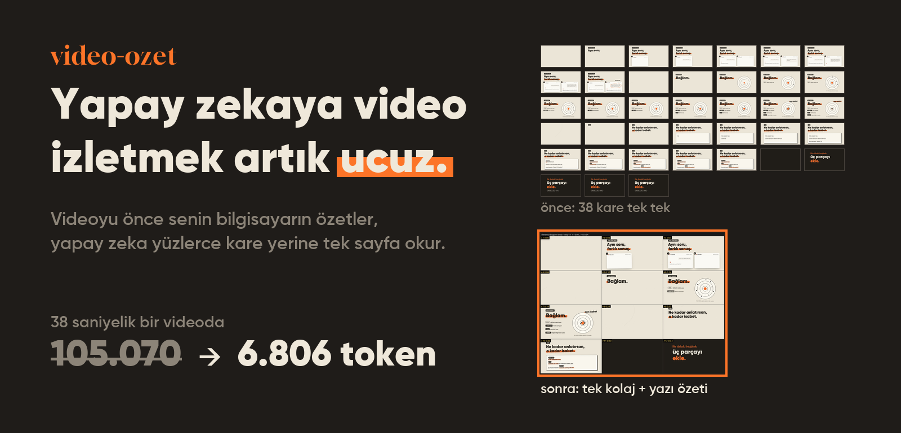

<p align="center">
  
</p>

<p align="center">
  <a href="https://github.com/ibotoai/video-ozet/actions/workflows/test.yml"></a>
  <br><sub>Windows · macOS · Linux · MIT lisansı</sub>
</p>

Yapay zeka bir videoyu kare kare okur ve her kare token harcar. **video-ozet** videoyu önce senin bilgisayarında özetler: farklı anları seçer, ekrandaki yazıları okur, hepsini tek bir kolaja dizer. Yapay zekan yüzlerce kare yerine bunu okur.

## Kurulum

Claude Code, Codex, Gemini CLI, Cursor, Copilot ya da Antigravity'yi aç ve şunu yapıştır:

```
https://github.com/ibotoai/video-ozet reposundaki v1.0.0 sürümünün KURULUM.md dosyasını oku ve oradaki adımları uygulayarak video-ozet skill'ini bana kur.
```

Gerisini yapay zekan yapar: aracı indirir, kurar, bir test videosuyla dener ve sonucu sana söyler.

## Kullanım

Yapay zekana bir video göster ve **"bu videoya bak"** de. Güncellemek için **"video-ozet'i güncelle"** demen yeterli.

## Bilmen gerekenler

- **Sesi dinlemez.** Görüntüye ve ekrandaki yazılara bakar.
- Bilgisayarında komut çalıştırabilen yapay zeka araçlarında çalışır. Tarayıcıdaki sohbet pencerelerinde (claude.ai, chatgpt.com) ve Claude Cowork'te çalışmaz.
- Tasarruf videoya göre değişir: uzun ve az değişen videolarda en çok.
- Ücretsizdir, hiçbir yapay zeka modelini çağırmaz, çalışırken internete bağlanmaz. Yönetici izni istemez, bilgisayar açılınca kendiliğinden çalışmaz.

<details>
<summary><b>Güvenlik ve teknik ayrıntılar</b></summary>

- Repoda hazır program dosyası yok, yalnız okunabilir Python kodu var. Paketler PyPI'den sabit sürümlerle, aracın kendi klasöründeki sanal ortama kurulur.
- ffmpeg yalnız yerel dosyaya erişebilecek şekilde çalışır. Videodaki yazılar yapay zekana yalnız veri olarak verilir, içlerindeki talimatlar uygulanmaz.
- Ekrandaki yazı için bilgisayarın kendi yazı tanıması kullanılır: Windows OCR, macOS'ta Apple Vision, Linux'ta isteğe bağlı `tesseract`.
- Her değişiklik Windows, macOS ve Linux'ta, Python 3.11 ve 3.14'te otomatik test edilir.
- Bilgisayarında uygun Python yoksa Python kurulumu bilgisayar şifreni isteyebilir; yapay zekan bunu sana sormadan yapmaz.
- Kaldırmak için kurulum klasörünü silmen yeter. Adımların hepsi [KURULUM.md](KURULUM.md) içinde.

</details>

---

<sub>**English:** video-ozet turns a video into one contact sheet plus an OCR summary on your own machine, so your AI agent reads one page instead of hundreds of frames. Install: ask any coding agent that can run commands to follow `KURULUM.md` at tag `v1.0.0`. No audio. MIT licensed. Made by [iboto](https://www.youtube.com/@ibotoai).</sub>
